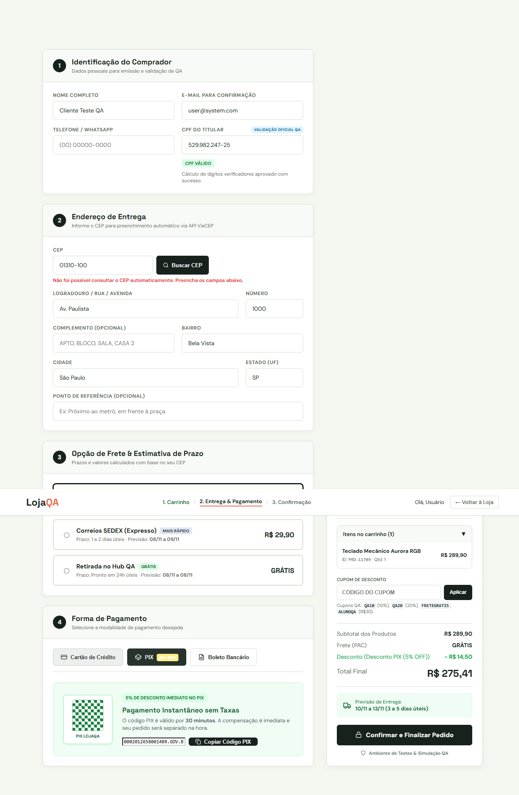
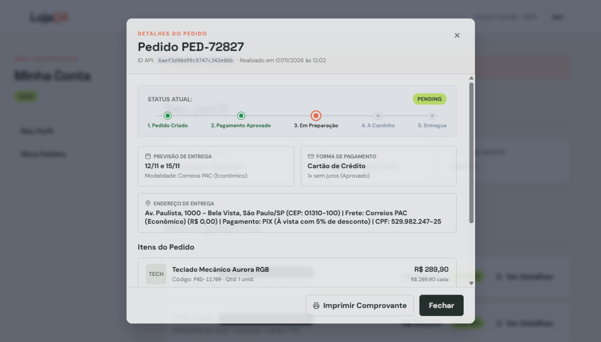

# LojaQA — módulo 07: pagamentos e criação de pedido

Programa FAP 2026, turma 4. Professor: Alison Melo.
Equipe: Fabiano Paiva, Marcos Cezar e Paulo Henrique.
Apresentação prevista no enunciado: **10/11/2026**.

Suíte Playwright com TypeScript para o módulo **07**, mais um E2E externo
(SauceDemo) e um teste de API externa (Reqres). O login é preparação da
sessão pela fixture; não é o foco dos testes da LojaQA.

## Instalação

Use Node.js LTS e, no PowerShell:

```powershell
npm.cmd ci
npx.cmd playwright install chromium
npm.cmd run typecheck
```

O `package-lock.json` faz parte da entrega para permitir `npm ci`.

## Execução da banca

```powershell
# 1. Módulo 07 em navegador visível
npm.cmd run test:e2e

# 2. API da LojaQA: status, Content-Type e JSON no console
npm.cmd run test:api

# 3. Um E2E externo e um teste de API externa
npm.cmd run test:externos

# Alternativa: os dez cenários em uma execução com navegador visível
npm.cmd run test:banca

# Relatório HTML
npm.cmd run report
```

`npm.cmd test` executa a mesma seleção completa. Os exemplos do módulo 12
ficam fora da suíte. A execução usa um worker, pois as compras compartilham
o cliente de demonstração e conferem o primeiro pedido da lista. Isso não
impede outro usuário do ambiente público de comprar com a mesma conta.

Não há `timeout`, `expect.timeout`, `actionTimeout` ou `navigationTimeout`
personalizados. Os limites padrão do Playwright continuam ativos. Não há
`waitForTimeout` nem pausas fixas. A sincronização depende de elementos,
respostas HTTP e asserções. Localmente o navegador fica visível; no CI ele
executa sem interface gráfica. Os scripts de banca forçam `--headed`.

## Matriz de testes

| ID | Tipo | Cenário | Resultado esperado |
| --- | --- | --- | --- |
| E2E-01 | UI | PIX | Desconto de 5% e total corretos; pedido criado e detalhes abertos |
| E2E-02 | UI | Cartão Mastercard | Bandeira detectada; pedido criado e detalhes abertos |
| E2E-03 | UI | Validade incompleta | Erro de preenchimento; permanece no checkout |
| E2E-04 | UI | Cartão vencido | Rejeição — defeito conhecido na aplicação |
| E2E-05 | UI | Carrinho vazio | Alerta e retorno à loja |
| API-01 | API | Compra de duas unidades | Status 201, JSON válido e estoque de 10 para 8 |
| API-02 | API | Quantidade maior que o estoque | Status 409 e estoque preservado |
| API-03 | API | Dois pedidos simultâneos de seis unidades, estoque dez | Um 201, outro 409 e estoque quatro — defeito conhecido na API |
| EXT-01 | UI externa | SauceDemo | Login e um item no carrinho |
| EXT-02 | API externa | Reqres | Status 201, Content-Type JSON e usuário retornado |

**Falhas esperadas não são regras de negócio aprovadas.** Dois cenários
usam `test.fail` para registrar defeitos reproduzidos. O Playwright pode
contá-los no total aceito, mas a equipe deve explicar essa diferença.
Veja as [evidências e limitações](docs/modulo-07-validacao.md).

## Organização

```text
data/                   Endereço, pagamentos e credenciais de demonstração
fixtures/auth.fixture.ts  Preparação da sessão autenticada
pages/CheckoutPage.ts     Seletores e ações do checkout, sem expect
pages/SauceDemoPage.ts    Seletores e ações do sistema externo
tests/e2e/               Interface do módulo 07 e SauceDemo
tests/api/               API do módulo 07 e Reqres
docs/                    Conformidade, defeitos e evidências
presentation/            Roteiro de seis slides; apresentação final pendente
examples/modulo-12/      Exemplos antigos preservados, não validados
```

Os cenários E2E são gerados pelas massas tipadas em `data/checkout.mass.ts`.
Cada cenário de API cria um produto exclusivo e o desativa no teardown,
mesmo se uma asserção falhar. Os pedidos reais continuam no histórico do
ambiente de demonstração. Page Objects contêm ações e seletores; as
asserções ficam nos testes e na preparação das fixtures.

## Ambientes e limitações

- UI: `https://alisonmelo.github.io/tioalison-pe-t4-fap26/projetos-base/01-sistema-login/loja.html`.
- API: `https://api-qa-fap2026.onrender.com/api`.
- SauceDemo: `https://www.saucedemo.com/`.
- Reqres: `https://reqres.in/api/users`. O serviço público pode aplicar limites.

O formulário é preenchido com endereço de teste. A consulta ViaCEP é
bloqueada somente nesses cenários; validação de CEP pertence ao módulo 05.
Nenhuma resposta de criação de pedido é simulada ou modificada. A resposta
real é lida antes do redirecionamento para obter o ID do pedido. Como a
aplicação redireciona com `orderId=undefined`, o teste abre o primeiro pedido
da lista e compara seu ID com a API antes de validar o modal.

O desconto PIX é validado no resumo da UI, não no total persistido da API.
A baixa simples de estoque passa; a garantia de atomicidade sob concorrência
falha. Não há código da aplicação/servidor neste repositório para corrigir
esses defeitos.

## Evidências da execução

O relatório HTML inclui capturas do resumo PIX e do modal do pedido, além
de screenshots, vídeo e trace nas falhas. Prints da revisão:





## Entrega da atividade

- [Repositório da equipe](https://github.com/marcoscezar19/lojaqa-automacao-banca).
- [Conferência do PDF por requisito](docs/conformidade-atividade.md).
- [Roteiro de seis slides](presentation/roteiro-slides.md).
- **Pendente:** montar/exportar os slides finais (PDF ou link), ensaiar a
  participação dos três integrantes e enviar repositório + slides no Moodle.

O roteiro não substitui a apresentação final. As alterações locais precisam
ser publicadas pela equipe antes da entrega.
